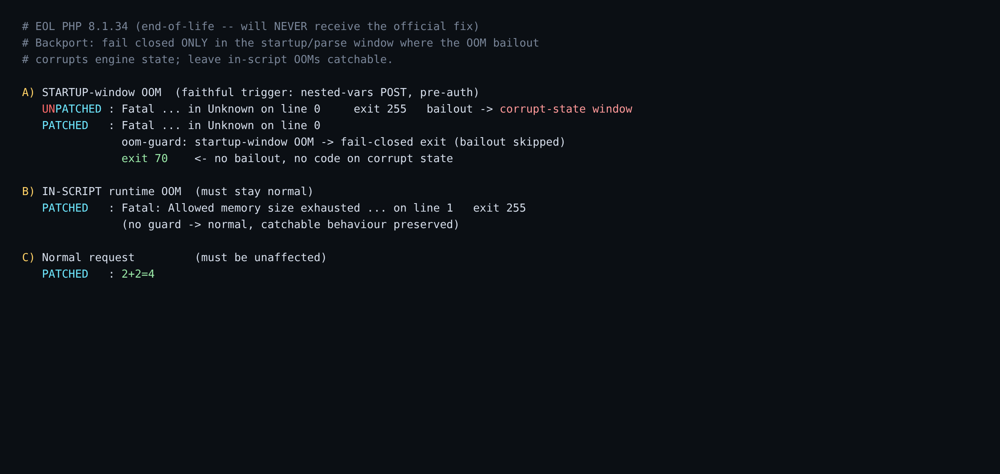

# EOL backport — fail-closed OOM guard

CVE-2026-109618 / 109619 are fixed in PHP 8.2.35 / 8.3.36 / 8.4.27 / 8.5.12.
**PHP ≤ 8.1 is end-of-life and will never receive the fix**, yet a large share
of production still runs 7.x/8.0/8.1. This is a surgical, buildable mitigation
for those systems, derived from the official fix's "hard exit" idea.

## What it does

The official fix (commit `3584a98bda`) stops the engine from `longjmp`-ing out of
an out-of-memory condition — a bailout raised during **request startup** unwinds
through half-initialised state and leaves it corrupt (the pre-auth memory-safety
core of both CVEs). That fix spans ~300 files and cannot be cleanly replayed on
8.1.

This patch instead changes the single OOM choke point, `zend_mm_safe_error()`:

- capture at entry whether we are in the startup/parse window
  (`EG(current_execute_data) == NULL`), **before** `zend_error_noreturn()` can
  alter executor state;
- if so, report the error and `_exit(70)` immediately instead of
  `zend_bailout()` — no code runs on corrupt state;
- in-script OOMs (execute_data set) keep normal, catchable behaviour.

See [`zend_alloc_oom_guard.patch`](zend_alloc_oom_guard.patch).

## Proven behaviour (PHP 8.1.34)

| Case | Unpatched | Patched |
|------|-----------|---------|
| Startup-window OOM (faithful nested-vars POST) | bailout → `exit 255` | guard → `exit 70`, bailout skipped |
| In-script runtime OOM | normal fatal | **unchanged** — normal fatal, no guard |
| Normal request | works | works |



## Build & verify

```bash
# in a throwaway debian:bookworm container with build tools:
curl -fsSLO https://www.php.net/distributions/php-8.1.34.tar.gz
tar xf php-8.1.34.tar.gz && cd php-8.1.34
patch -p1 < /path/to/zend_alloc_oom_guard.patch     # or apply the two hunks by hand
./configure --disable-all --enable-cli --enable-cgi --enable-session
make -j"$(nproc)"

# startup-window OOM -> fail-closed (guard fires, exit 70)
printf 'a[]%.0s' {1..1} >/dev/null  # see research/ for the nested-vars body generator
```

The repeatable trigger and harness are in [`../research/`](../research).

## Tradeoff

A startup-window OOM now terminates the worker (FPM respawns it). That's the same
availability outcome the vulnerable build already had on this path — it exited
with code 70 — minus the exploitable corrupt-state window. It is a stopgap, not a
substitute for upgrading off EOL PHP.
