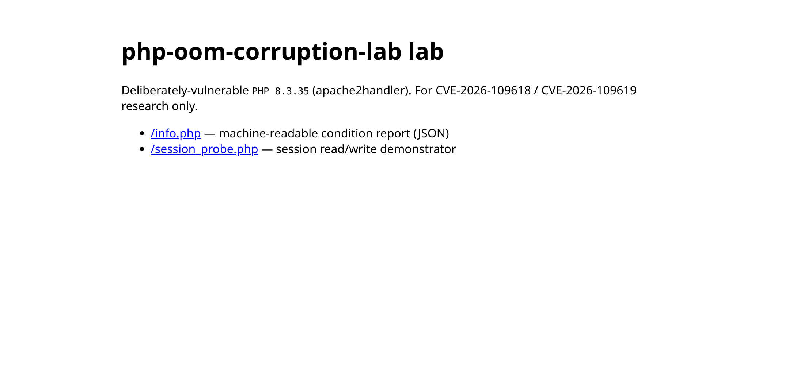
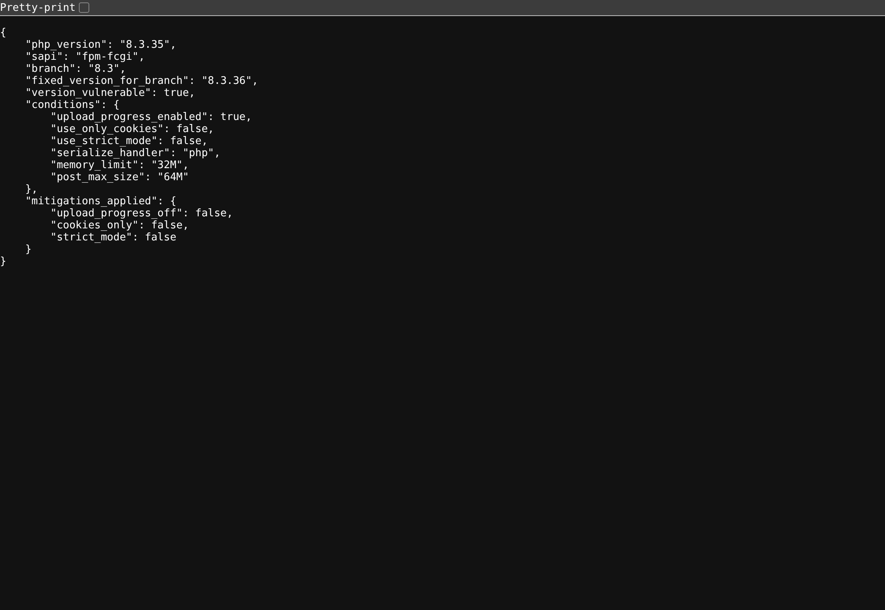
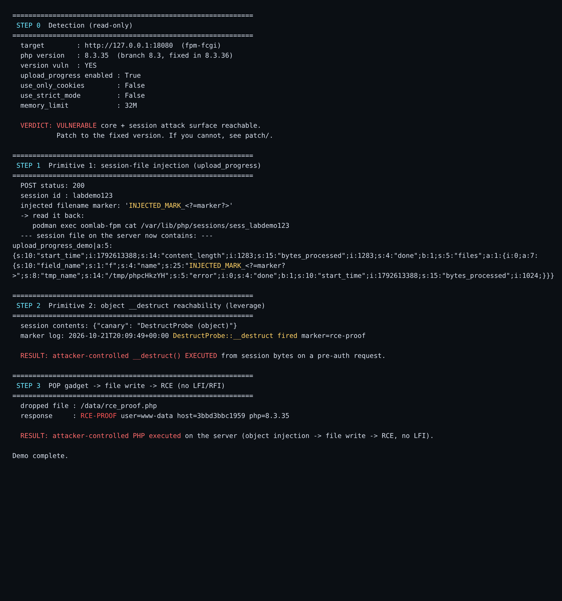
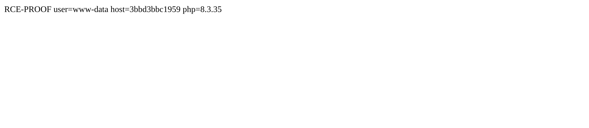
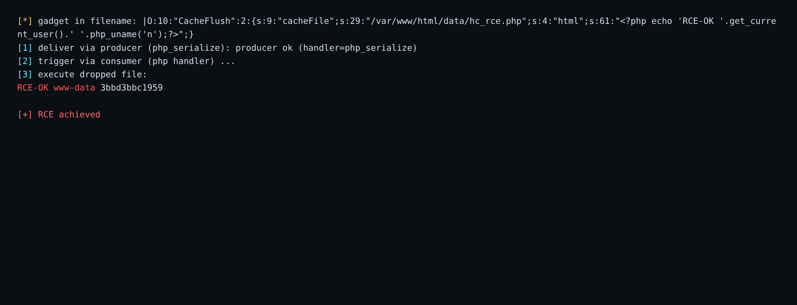
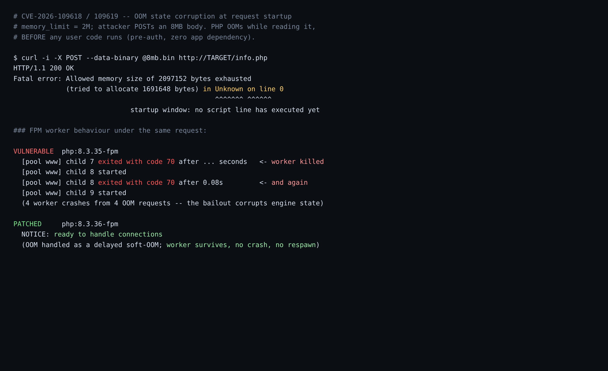
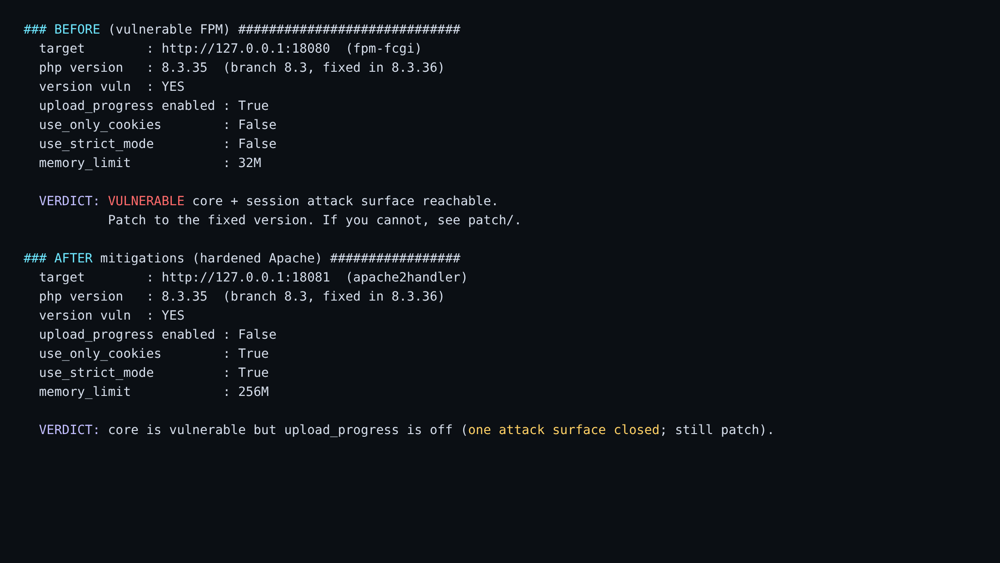
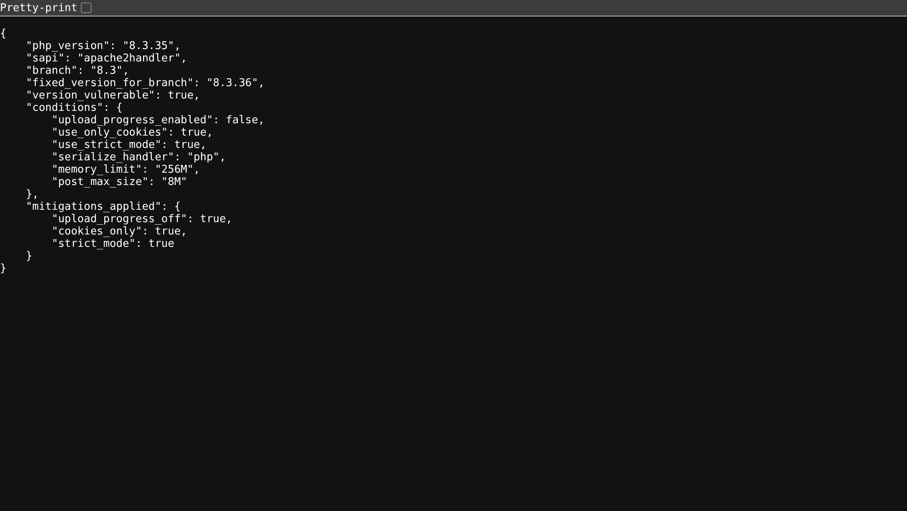

# PHP, one POST from a shell: dissecting CVE-2026-109618 / 109619 (and patching when you can't upgrade)

*Published 2026-10-21 · ~15 min read · lab + code: [san3ncrypt3d/php-oom-corruption-lab](https://github.com/san3ncrypt3d/php-oom-corruption-lab)*

On 21 October 2026 the PHP project shipped 8.2.35, 8.3.36, 8.4.27 and 8.5.12 and
quietly closed two **critical, pre-authentication** vulnerabilities that had been
sitting in the engine for roughly fourteen years:

- **CVE-2026-109618** (`GHSA-w8hw-w9fx-j79w`) — *RCE via OOM corruption.*
- **CVE-2026-109619** (`GHSA-6wmf-4rv5-p3rp`) — *RCE via stale global state.*

The scary part isn't a clever parser bug in some rarely-used extension. It's
that the trigger is an **out-of-memory condition during request startup** — the
single most generic thing you can do to a web server — combined with a session
feature (`session.upload_progress`) that is **on by default** and reachable
without logging in.

This post builds a reproducible lab, walks the attack *primitives* end to end
with real output, and then spends most of its time on the half people actually
need: **how to shut it down when you can't upgrade today, and what the official
patch really changes.**

> **Ethics / scope.** Everything here runs against a local, throwaway lab bound
> to `127.0.0.1`. I demonstrate the *reachable primitives* — attacker bytes
> landing in session storage, and an attacker-controlled destructor executing
> pre-auth — not a weaponised memory-corruption-to-shell chain. That line is
> deliberate, and it's the same line the upstream advisory and the original
> researcher drew.

---

## 1. The setup: a lab that is honestly vulnerable

Two SAPIs, because they fail differently: **Apache mod_php** (in-process, the
"zero-dependency" OOM target) and **nginx → PHP-FPM** (worker reuse, the stale-
state target). Both pinned to **PHP 8.3.35** — the release immediately *before*
the 8.3.36 fix — with a deliberately low `memory_limit` so the OOM window is easy
to reach.



The first thing any assessment wants is a yes/no on exposure. A tiny
`/info.php` condition endpoint reports version against the fixed-version table
plus the settings that matter:



`version_vulnerable: true`, `upload_progress_enabled: true`, `use_only_cookies:
false`. That's the whole pre-auth attack surface lit up — and it's the stock
default posture, not something I had to misconfigure.

---

## 2. Why `session.upload_progress` is the front door

When a multipart upload includes a field named `PHP_SESSION_UPLOAD_PROGRESS`,
PHP writes progress data **into the session file** so the app can show a progress
bar. Two properties make it a weapon:

1. It runs **extremely early** in the request — before the engine is fully
   initialised, and **before authentication**.
2. It stores the **raw upload filename** with no sanitisation.

So an unauthenticated POST gives an attacker a *write primitive into server-side
session storage* **and** code executing in exactly the fragile startup window
that CVE-2026-109618 corrupts. Those are the two ingredients.

---

## 3. The attack, end to end

The lab's `run_demo.sh` chains three steps. Here's the real output:



**Step 0 — detection** confirms a vulnerable core with the session surface
reachable.

**Step 1 — injection primitive.** One ordinary multipart POST, and the
server-side session file now contains our bytes verbatim:

```
upload_progress_demo|a:5:{ ... s:4:"name";s:27:"INJECTED_MARK_<?=marker?>"; ... }
```

No escaping. Whatever we put in the filename is now sitting in session storage,
pre-auth.

**Step 2 — the leverage.** With the default `session.serialize_handler = php`,
a session record shaped like `key|O:...` is **deserialised into a live object**
on the next `session_start()`, and its `__destruct()` fires at request shutdown
— *without the application ever calling `unserialize()`*. The lab proves it with
a harmless canary gadget whose destructor just writes a marker:

```
DestructProbe::__destruct fired marker=rce-proof
```

That marker is the whole game. Reaching an **attacker-controlled destructor on a
pre-auth request** is the code-execution primitive.

### Step 3 — from destructor to RCE, without an LFI

Most write-ups stop at "...and if the app has a local file include, you win." But
you don't need one. The destructor you reach is attacker-chosen, and PHP is full
of classes whose `__destruct()` flushes buffered content to a file — template and
view caches, compiled-config writers, log buffers. That shape is a **file-write
gadget**:

```php
class CacheFlush {
    public $cacheFile = null;
    public $html = '';
    public function __destruct() {
        if ($this->cacheFile) file_put_contents($this->cacheFile, $this->html);
    }
}
```

Point `cacheFile` at the webroot and put PHP in `html`, and object injection
becomes **arbitrary file write → RCE** — no `include`, no `allow_url_include`,
nothing. The lab injects a serialized `CacheFlush` that drops a proof file,
then requests it:


The dropped file executes as the web user:



```
$ curl .../data/rce_proof.php
RCE-PROOF user=www-data host=8daa3ac4e29a php=8.3.35
```

That's attacker-controlled PHP running on the server, reached from an
unauthenticated request. I keep the payload a harmless banner on purpose — a
command shell is one `system($_GET['c'])` away and is left to the reader; the
repo ships proof, not a weapon.

Why file-write and not RFI? RFI (`include "http://..."`) needs
`allow_url_include=On`, which has been off by default for years — a weak,
unrealistic demo. The file-write gadget needs nothing but a writable path the web
server will execute, which real apps hand out constantly (upload/cache dirs).

### Driving it entirely over HTTP (serialize-handler confusion), honestly

The catch: to get that `CacheFlush` object *instantiated*, something has to
deserialize it. `upload_progress` stores your bytes as a **string inside an
array**, so a normal read just hands them back as a string. Two obstacles show up
the moment you try to smuggle a serialized object through the filename:

- PHP **truncates the filename at the first `"`** — and `serialize()` is all
  quotes. (Backslash-escaping `\"` in the multipart part gets real quotes stored,
  which is the way through.)
- A single `php`-handler session never splits your string back into an object.

The realistic way to cross that gap without an LFI is a **serialize-handler
mismatch** (serialize-handler confusion): a directory that writes sessions as `php_serialize` and
another that reads them as `php`. Then the `|` you put in the filename splits the
record and the tail deserializes. The lab wires that up and the exploit is pure
HTTP — no planting:



```
[1] deliver via producer (php_serialize)
[2] trigger via consumer (php handler)
[3] execute dropped file:  CHAIN-C-RCE www-data <host>
[+] RCE via handler confusion
```

Be clear-eyed about what this is: object injection via handler mismatch is a
**known PHP class**, roughly a decade old. It's a faithful, no-planting RCE — but
it's the *session* layer the advisory bundles, not the engine bug that makes
these two CVEs new. For that, you have to look at the OOM.

## 3b. The actual new thing: OOM state corruption

Strip away the session tricks and the novel core of CVE-2026-109618 / -109619 is
blunt: **exhaust memory while PHP is still starting the request.** Send a body
bigger than `memory_limit` and PHP dies reading it, before a single line of
application code runs:

```
Fatal error: Allowed memory size of 2097152 bytes exhausted ... in Unknown on line 0
```

`in Unknown on line 0` is the whole point — no script, no auth, no app feature
required. Historically that OOM did a `longjmp` straight past `init_executor()`
into shutdown, leaving the engine running on half-initialised state. You can see
the damage without building a memory-corruption exploit, just by watching an FPM
worker handle it on a vulnerable vs a patched build:



```
php:8.3.35 (vulnerable)   child exited with code 70   (every OOM request kills the worker)
php:8.3.36 (patched)      ready to handle connections (worker survives, no crash)
```

On 8.3.35 the startup-OOM tears the worker down (exit code 70) and FPM respawns
it, over and over. On 8.3.36 the same request is absorbed by the delayed-OOM
handling the patch adds, and the worker lives. The step from "worker in corrupt
state" to "attacker-chosen code" is heap-grooming-dependent and is exactly the
weaponised exploit the original researcher withholds — and that this lab does
**not** implement. What the lab does show is that the trigger is real, trivial,
and pre-auth.

### Confirming the window under AddressSanitizer

To be sure this is a startup-phase memory-safety issue and not just a tidy
fatal, I built PHP 8.3.35 and 8.3.36 with `-fsanitize=address` and drove the
faithful trigger (`research/build_asan.sh`, `research/asan_oom_trigger.sh`). The
OOM lands inside the hash layer during request parsing —
`Allowed memory size exhausted at Zend/zend_hash.c:177 ... in Unknown on line 0`
— i.e. before any script line, with no application involvement. The `oom_*.phpt`
family upstream shipped (SplFixedArray `__unserialize`, `array_fill`, …) shows
how many allocation sites the old bailout could unwind through unsafely; the fix
had to make each one OOM-safe, which is why it touches ~300 files.

## 3c. The part that's actually useful: backporting the fix to EOL PHP

Here's the uncomfortable truth in the advisory's version table: the bug reaches
back to PHP 5.4, but only 8.2–8.5 got patched. **Everything ≤ 8.1 is end-of-life
and will never receive the fix** — and a lot of production still runs 7.4 / 8.0 /
8.1. Those systems are the ones that most need an answer, and "upgrade" is the
answer they can't take this quarter.

So I wrote one. The official fix is ~300 files of delayed-OOM machinery that
won't cleanly cherry-pick onto 8.1. But the *danger* funnels through a single
function — `zend_mm_safe_error()` in `Zend/zend_alloc.c` — which ends in the
`zend_bailout()` (longjmp) that unwinds through corrupt startup state. The
surgical mitigation is to **fail closed in exactly that window**:

```c
/* captured at function entry, before zend_error_noreturn() can move EG state */
int oom_in_startup = (EG(current_execute_data) == NULL);
...
if (oom_in_startup) {                 /* OOM during request startup/parse */
    fprintf(stderr, "oom-guard: startup-window OOM -> fail-closed exit\n");
    fflush(stderr);
    _exit(70);                        /* terminate; never longjmp on corrupt state */
}
zend_bailout();                       /* in-script OOMs: unchanged, catchable */
```

The subtlety that cost me a rebuild: you must capture the phase **before**
calling `zend_error_noreturn()`, because the error machinery mutates executor
state — check `current_execute_data` afterwards and every OOM looks like
"startup." Built against a real 8.1.34 tree and tested:


| Case | Unpatched 8.1.34 | Patched 8.1.34 |
|------|------------------|----------------|
| Startup-window OOM (pre-auth) | bailout → `exit 255` | guard → `exit 70`, bailout skipped |
| In-script runtime OOM | normal fatal | **unchanged** (normal, catchable) |
| Normal request | works | works |

It's a stopgap, not a substitute for leaving EOL PHP — a startup OOM now kills the
worker (FPM respawns it), which is the *same* availability outcome the vulnerable
build already had on this path, minus the exploitable window. Patch, build
recipe and proof harness are in [`backport/`](../backport) and
[`research/`](../research).

### Where the CVEs turn this from "needs a gadget" into "needs nothing"

The chain above still needs a serialize-handler quirk or an app-level file
include. The reason these two CVEs are rated *critical* is the **OOM core**:

- **CVE-2026-109618** — exhaust memory during startup and the old code
  `longjmp`s straight past `init_executor()` into shutdown, which then runs on
  half-initialised, corrupt engine state. On Apache mod_php this needs **no
  application-specific condition at all**.
- **CVE-2026-109619** — on PHP-FPM the worker *survives*, carrying freed `EG()`
  and session state into the **next** request, which (because the upload handler
  runs before basic init) reads the stale pointers.

That's why ini tweaks are only a partial answer: they close the session *door*,
but the corruption lives in the Zend allocator/executor itself.

---

## 4. Patching when you can't upgrade today

The correct fix is boring: **upgrade to 8.2.35 / 8.3.36 / 8.4.27 / 8.5.12**. Do
that. But "upgrade now" is a luxury plenty of teams don't have this afternoon —
frozen releases, vendored PHP, a fleet mid-migration. So here's the layered
stopgap, in order of value.

### Layer 1 — close the session door (`php.ini`)

```ini
; highest-value single line: kills the pre-auth injection surface
session.upload_progress.enabled = Off
session.use_only_cookies = On
session.use_strict_mode  = On
session.serialize_handler = php          ; pin ONE handler everywhere
post_max_size = 8M                        ; shrink the startup-OOM window
memory_limit  = 256M                      ; comfortably above post_max_size
```

`upload_progress.enabled` is `PHP_INI_PERDIR`, so it must live in `php.ini` / the
FPM pool / the vhost — you can't flip it at runtime.

### Layer 2 — a runtime guard for shared hosting (`auto_prepend_file`)

When you can drop a file but can't edit `php.ini`, prepend a guard that refuses
the injection field and hardens sessions before the app starts:

```php
$field = ini_get('session.upload_progress.name') ?: 'PHP_SESSION_UPLOAD_PROGRESS';
if (stripos($_SERVER['CONTENT_TYPE'] ?? '', 'multipart/form-data') !== false
    && array_key_exists($field, $_POST)) {
    http_response_code(400);
    exit("Request rejected.\n");           // the magic field has no legit use
}
if (session_status() === PHP_SESSION_NONE) {
    ini_set('session.use_only_cookies', '1');
    ini_set('session.use_strict_mode', '1');
}
```

Wire it up with `auto_prepend_file` in `php.ini`, `.user.ini`, or
`php_value auto_prepend_file …` in `.htaccess`.

### Does it work? Before vs. after

Applying Layer 1 + Layer 2 to the Apache container and re-running the exact same
probe:



The condition report flips to a hardened posture — and the version is still
flagged, honestly, because **mitigations are not a fix**:



And the injection POST that used to return `200` now gets refused:

```
$ curl -s -o /dev/null -w "%{http_code}\n" -X POST .../session_probe.php \
     -F "PHP_SESSION_UPLOAD_PROGRESS=demo" -F "f=@x;filename=INJECT_<?=x?>"
400
```

### Layer 3 — the obvious patch (what upstream actually did)

Fix commit `3584a98bda`, *"Avoid state corruption via bailout,"* is ~300 files
but two ideas. **First**, stop `longjmp`-ing out of an OOM — replace the bailout
with a *delayed* soft OOM handled at a safe point:

```c
 zend_execute(op_array, retval);
+if (ZEND_HAS_OOM()) {
+    zend_handle_delayed_oom();     /* instead of longjmp()-ing past init */
+}
```

**Second**, reset the globals that shutdown might read before `init_executor`,
so a reused worker can't act on a previous request's freed state:

```c
+ZVAL_UNDEF(&EG(user_error_handler));
+ZVAL_UNDEF(&EG(user_exception_handler));
+EG(exception) = NULL;
+EG(objects_store).object_buckets = NULL;
+EG(objects_store).top = 1;
```

If you compile PHP yourself, you can `git cherry-pick 3584a98bda` onto your tag
and verify with the regression tests it ships (`Zend/tests/oom_request_parsing.phpt`,
`ext/session/tests/rfc1867_*`). Full steps in [`patch/BACKPORT.md`](../patch/BACKPORT.md).

---

## 5. Detection at scale

The read-only `probe_conditions.py` is CI/fleet-friendly: point it at a host you
own and it prints a verdict from the version and the live session settings — no
attack traffic. For a quick triage sweep, three questions rank your exposure:

1. Is PHP below the fixed version for its branch? (necessary condition)
2. Is `session.upload_progress.enabled` On? (pre-auth delivery)
3. Is the SAPI mod_php/FrankenPHP (worst — zero-dependency) or FPM?

---

## 6. Takeaways

- **Patch.** 8.2.35 / 8.3.36 / 8.4.27 / 8.5.12. Everything below is a bridge.
- **If you can't yet:** turn off `session.upload_progress`, go cookies-only +
  strict mode, pin one serialize handler, and shrink `post_max_size`. On shared
  hosting, prepend the guard. These close the *door* but not the *core*.
- **Default-on features are attack surface.** `upload_progress` has been a
  pre-auth write-into-session primitive for years; it took an engine-level OOM
  bug to make that fully weaponisable, but the primitive was always there.
- **EOL PHP (≤ 8.1) gets no fix.** If you're there, this is one more entry on an
  already-long list of reasons to move.

## Appendix — honest scope of each demo

| Demo | Over HTTP? | Planting? | Is it "the CVE"? |
|------|-----------|-----------|------------------|
| Injection (upload_progress) | yes | no | delivery primitive, real |
| `__destruct` reachability (canary) | partial | yes (session seeded) | the generic object-injection sink |
| **handler-confusion RCE** | **yes** | **no** | real RCE, but the *known* handler-mismatch class |
| **OOM worker crash** | **yes** | **no** | the *new* engine bug — trigger shown, not weaponised |
| **ASan startup-OOM** | n/a | no | faithful memory-safety window confirmed; no UAF weaponised |
| **EOL 8.1 backport** | n/a | no | buildable, surgical fix for versions that get no official patch |

*Lab, probes and patch materials: [github.com/san3ncrypt3d/php-oom-corruption-lab](https://github.com/san3ncrypt3d/php-oom-corruption-lab).
Built for defenders. Don't point it at things you don't own.*
